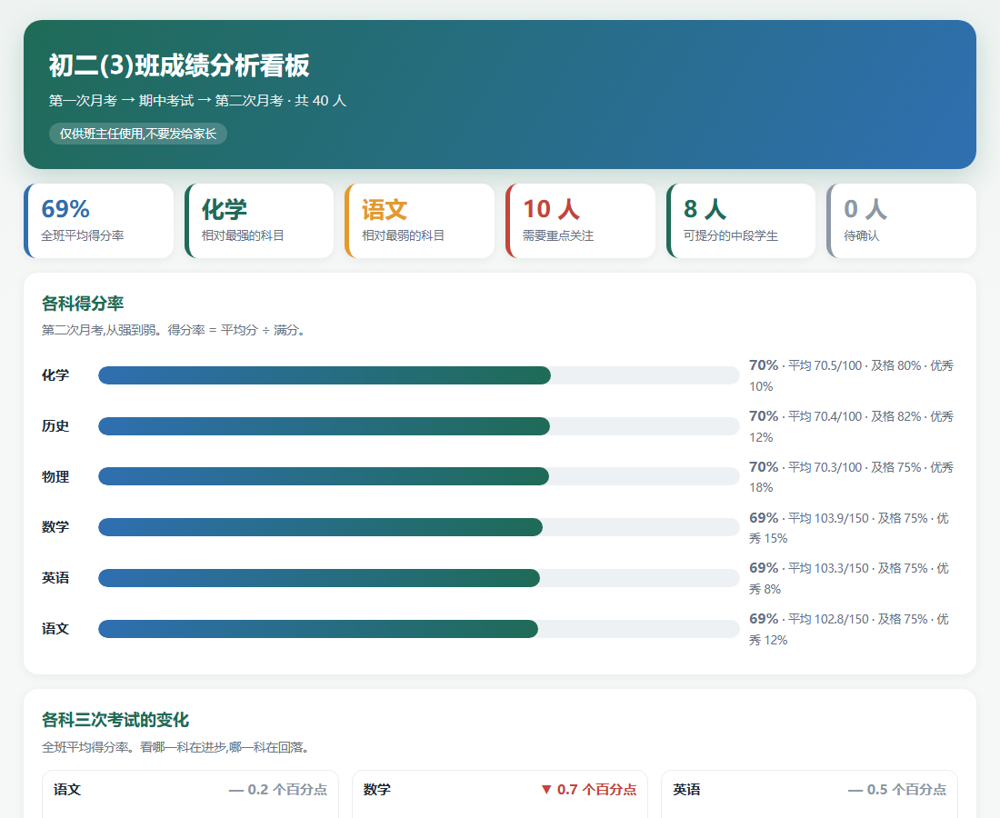
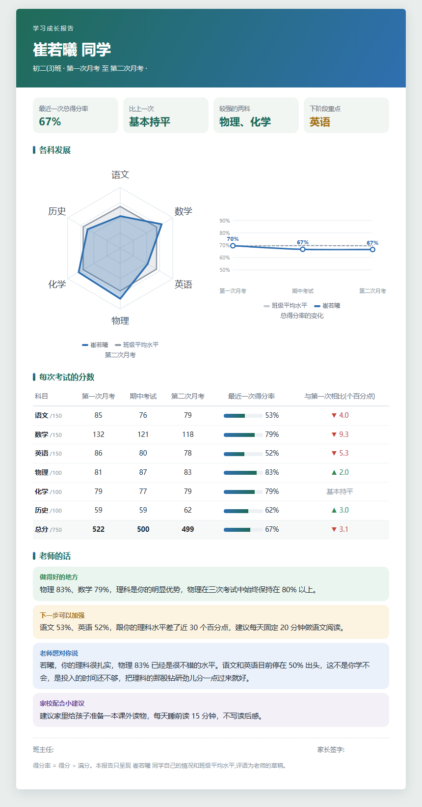

# class-score-dashboard

班主任的成绩看板 skill。把多次考试的成绩表（Excel）交给 WorkBuddy，一句话得到两样东西：

1. **班主任看板**（只给班主任）：各科得分率、各科三次考试的变化、全班总分分布、成绩热力图、红黄绿名单、可提分的中段学生，以及小结和教学建议。
2. **学生个人报告**（给家长）：每位同学一份，约一页 A4，可以打印。只有这位同学自己的成绩和班级平均水平，没有排名，也没有别的同学的信息。

用虚构的示例数据（40 人、三次考试）跑下来，WorkBuddy 页面显示用时 2 分 56 秒。





## 安装

把整个 `class-score-dashboard` 文件夹放进 WorkBuddy 的 skills 文件夹（Windows 上一般在用户文件夹下的 `.workbuddy\skills`）。

## 使用

在 WorkBuddy 里新建任务，先用自带的示例试一遍：

```text
请使用 class-score-dashboard 这个 skill，用它自带的示例成绩表演示一遍。班级名称：初二(3)班。
```

换成自己班的成绩表：先把成绩表作为附件上传，再发：

```text
请使用 class-score-dashboard 这个 skill，处理我上传的成绩表。班级名称：初二(3)班，班主任：张老师。
```

结果在 WorkBuddy 给这次任务建的文件夹里，双击 `班级成绩分析看板.html` 打开；点表格里的学生姓名，就能看到他的报告。里面的评语是 AI 写的草稿，发给家长之前按你班的情况改一改。

## 成绩表的格式

每个工作表是一次考试，按时间顺序排。表头是学号、姓名，然后是各科成绩，科目名后面写满分，比如 `语文(满分150)`。某次缺考的学生，那一次的成绩留空。示例见 `examples/班级成绩表-示例.xlsx`。

## 工作方式

- `scripts/analyze.py`：读成绩表，用代码算出所有数字（得分率、及格率、红黄绿名单、可提分的中段学生），写成 `analysis.json`。
- AI 读 `analysis.json`，为每位学生写评语和建议，存成 `comments.json`。评语只能用程序算出来的数字。
- `scripts/build_class.py`、`scripts/build_reports.py`：把两份 JSON 合成班主任看板和学生报告，都是单个 HTML 文件，离线能打开。

完整的步骤和规则见 [SKILL.md](SKILL.md)。

## 目录

```
class-score-dashboard/
├── SKILL.md
├── scripts/
├── examples/班级成绩表-示例.xlsx   虚构的示例数据
└── docs/
```

## 许可

MIT，见 [LICENSE](LICENSE)。
